# On the surface
***Flags your professional life is being targeted***

<a href="https://" target="_blank">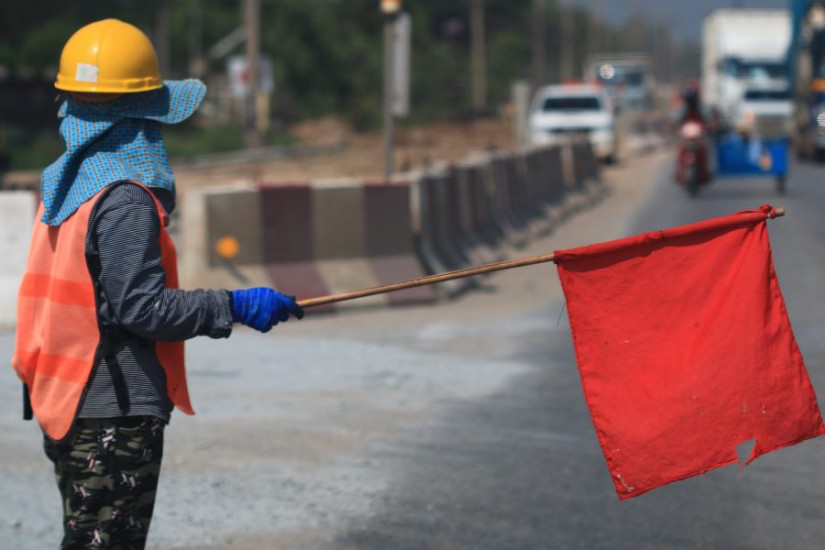</a>

***This is what a professional hitjob looks like. This could potentially be nation state actors, third party professionals, or even a corporation. As it turns out, it's been an extortion attempt all along, with the participation of multiple communities watching in glee. Who knew?***

<a href="https://youtu.be/F7FppXJ-3YY" target="_blank">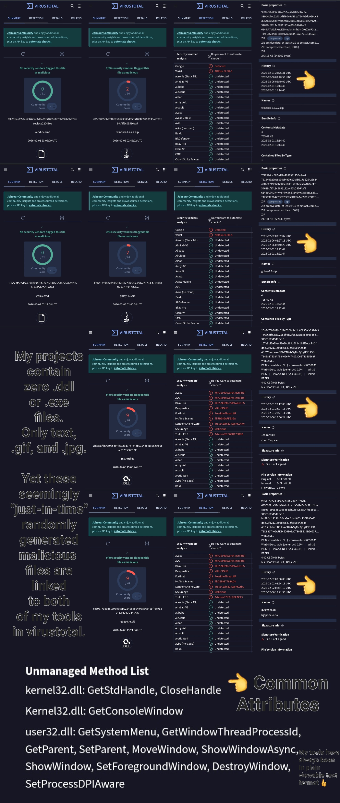</a>

***I've been in a state of constant grief, theft, and harassment since the very beginning of development. Now they know everyone knows about it, so they stopped trying to hide.***
- Back in December of 2022, a few weeks after the first release here on github, they created a new YouTube account that had the creation date of 12/1/2022 with the same handle 'joshuacline' as my legal name and github account. That account has since been deleted and replaced with yet another 'joshuacline' handle seemingly created in 2024. They are running rotations of username handles to stifle, sabatoge, and destroy morale of new unsuspecting software developers. It's reprehensible and disgusting.
- They ruined the results for every search engine, and VirusTotal results as well, ***permanently***. Additionally they ruined the results for my full legal name with nasty nasty stuff. So I decided to go through a rebranding effort, and see how well it turns out.
- It started out great. Now featuring a spotless clean bill of health, and no prior tools or pesky search results for 'WinPloy'. See it for yourself: https://www.virustotal.com/gui/file/9b7c35d8f7996dfc870dab2d8709289b9068b264b3915388154892a25442b1fe/
<a href=" " target="_blank">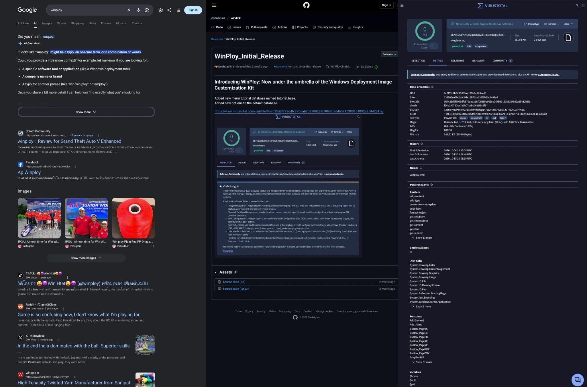</a>

- No longer than 4 days after rebranding, the new name has been stolen, along with the search results.
<a href=" " target="_blank">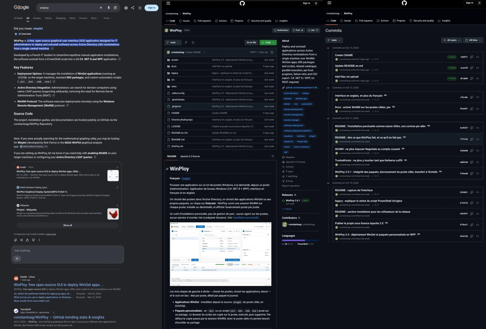</a>

***It's more than name squatting. Hence, the features and description. It's meant to defraud and mislead users, and to divert traffic from my project that I've spent over five years developing. These are the same exact folks over and over, who think that they're clever and that they've fooled everyone by pretending to be from many different places with several different foreign languages. It's fake and is likely originating from the U.S. and Germany. Projects and fake software portfolios are being created via AI in a near instant, then are being passed around to highest bidders, influencers, or are being maliciously weaponized. Meanwhile, my project has had zero media coverage, not an article, not a video, nothing.***

- Several prominent online communities know the originating names, developers, and affiliated Windows tools responsible. Never will I ***ever***, ***EVER*** let this go until these communities and responsible parties are held to account. ***Do not become a software developer, they will attack you, your reputation, your place of employment, your social circle, trying to get you evicted onto the street, and will continue to attack you seemingly until you're dead. They'll reward those who damage you, while damaging those who help you. These people are literally the worst type of scum in existence. It's surreal, and unfortunately real.*** 

# Deep below
***Flags your circle has been social engineered***
- 1. Old friends, acquaintances, exces, contacting you to glean information. It may be a just little chat to start. Things might get weird later. Anything obtained about you whether it be real, fake, or perceived, will be used to spider their way through your network.
- 2. Don't wait. Friends, family, roommates, or even coworkers who could have been a witness, can now be blackmailed after their participation.
- 3. You've waited too long. At this point it's self preservation. They must continue to harass or collect information on you, or else.
- 4. There's a new kind of unpersoning, and it's more sinister than you think. They could be attacking your social circle so there's nobody left to speak up when your reputation is under assault. Since they cannot erase the past, the next best thing is neutralizing the witnesses. For example, let's say you were ***the*** stud or mister popular throughout your college years. Simple facts such as this diametrically opposes and would unravel the narrative of you being a 'McLovin' or a 'creepy Cameron'. Likely these are precisely the archetypes belonging to the individuals who are doing the attacking. Ironic but not surprising. ***Stay in touch with old friends, especially if you notice something is not right.***
- 5. Strange new friend requests, or even stranger requests from established friends? What about that old buddy who's been pushing daisies for 8 years hovering to the top of your friends list? Let the culling begin.
- 6. Social media oddities. News feed from hell? No matter how many times you remove the schit it keeps coming back. Don't be disappointed after you find out it isn't the apps platform.
- 7. Feeling sensitized? Seeing same or similar keywords or user handles on a particular site, over and again with slight variances relating to ongoing threats, a loved ones death, past relationships, or any traumatic experience? The internet is a vast place, giving room for plausible deniability. Don't wait, start collecting evidence until denial is no longer plausible.
- 8. Gaslighting. A bit of skepticism is healthy, but not when it comes to this. They are ruining your life, one person at a time.
- 9. Fake Dexters. Nobody plays the 'good guys' better than the bad ones. A frequently used exploit making it permissible to do what they do, but in the light with a captive audience. Sometimes things go wrong. Imagine a case of mistaken identity, then having to justify ruining a person's life, it happens.
- 10. Overton window breakers. Imagine having a set of specific circumstances you are dealing with. On the verge of reporting these 'issues' online, you notice fresh and active people with your same exact circumstances, all over the place. Except they're making it look ridiculous. You got beat to the punch.
- 11. Theft of course. Money, assets, or even government benefits stolen, but it doesn't stop there.
- 12. Weaponization of your vicinity. Imagine busting a housemate creeping around your room while you sleep. Mind you, the ***only*** three times you forgot to lock your room. What about waking up to phones and tablets slid underneath your door, wedged up with the camera pointed right towards your bed. Or how about being told you're being recorded on a semi-weekly basis? This was my life for nearly two years. Oh the things you'll put up with for cheap rent, but it may be costing you more than you realize.
- 13. Paid stalkers and paparazzi. Have a favorite place you eat at, or what about a trail you visit? We're not talking social experiments, but more along the lines of malicious surveillance. Unironically these risk-taking voyeur types are prone to making blatantly idiotic mistakes. Reports were promptly filed with the police.
- 14. Coming home to disaster. Every single cord in the entire house has been physically severed in half. Electrical, ethernet, telephone, audio, and cable. Your home has the potential to be used as a warzone to wreck havoc upon you, or anyone else in the vicinity. Several reports were immediately filed with the police.

# Destroying the remnants of normalcy in a person's life achieves what exactly? 
- ***A recipe for making monsters through destabilization (of course)***

<a href="https://" target="_blank">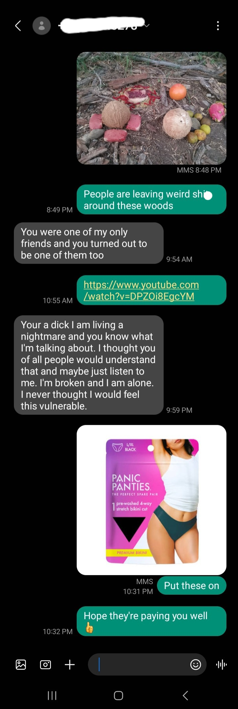</a>

- By the time you notice that anything remotely resembling regular conversation with friends or family is now a past-time, it's too late.

<a href="https://" target="_blank">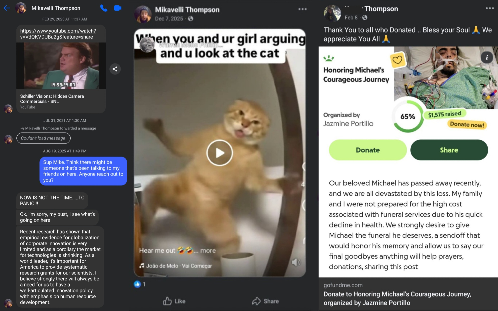</a>

# Public stalking, oddities, and harassment

<a href=" " target="_blank">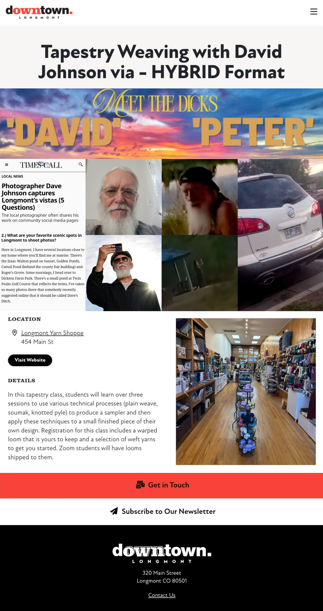</a>

- Without getting into the uncomfortable scenerios I've encountered or various strangers who've approached me in public since becoming a developer of operating system deployment tools, I'll say this - it's been unnerving. Here we have a gentleman that seemed alright at first glance, though looks can be deceiving. Sometimes you may have to take matters into your own hands, especially when they've been persistent after you've made it abundantly clear to leave you alone. What a creep. 

<a href="https://youtu.be/5sENQNspLC8" target="_blank">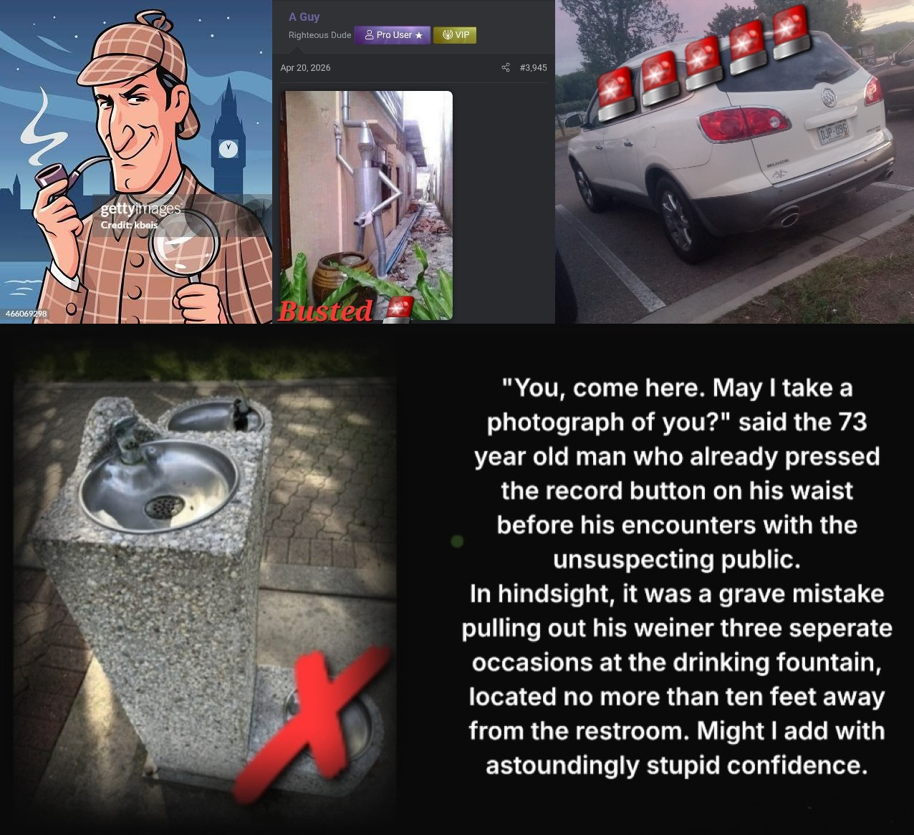</a>

## Your names will be revealed and made public, even if it's the last thing I do

<a href="https://youtu.be/eDuRoPIOBjE" target="_blank">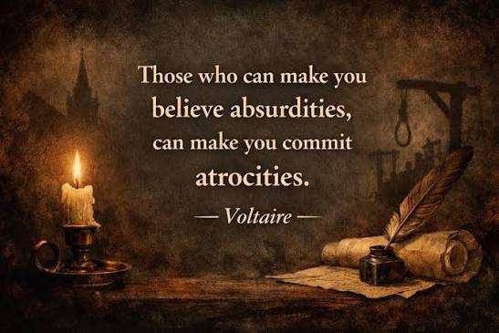</a>

- Every single online community knows ***exactly*** who's responsible, and the truth will eventually come out. In the meantime, your communities can look like the disgusting shite that they are.
- For anyone who's wondering, and I'm sure there's quite a few, the ***only*** legal trouble I've been in within nearly the past two decades is a ticket for expired plates. That's it.

<a href="https://youtu.be/5D3crqpClPY" target="_blank">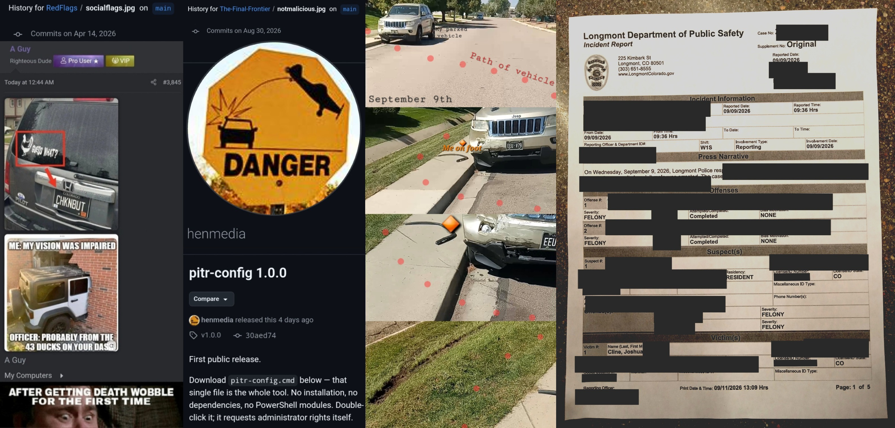</a>

- Part of the conspiracy, or uncovered conspiracy plot?

⚠️👇You decide👇⚠️

Amazing. Would you look at that, a clear-cut case of publice xtortion. Who knew?

<a href=" " target="_blank">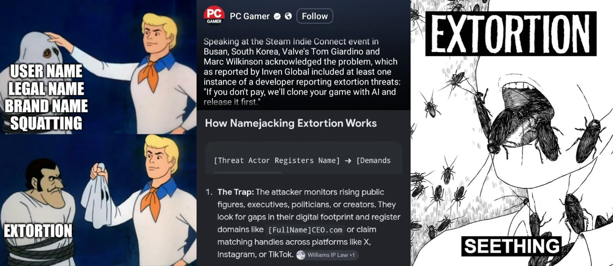</a>

You'll never get single a penny from me, I can assure you that.

<a href="https://youtu.be/vpdJI0gg4IU" target="_blank">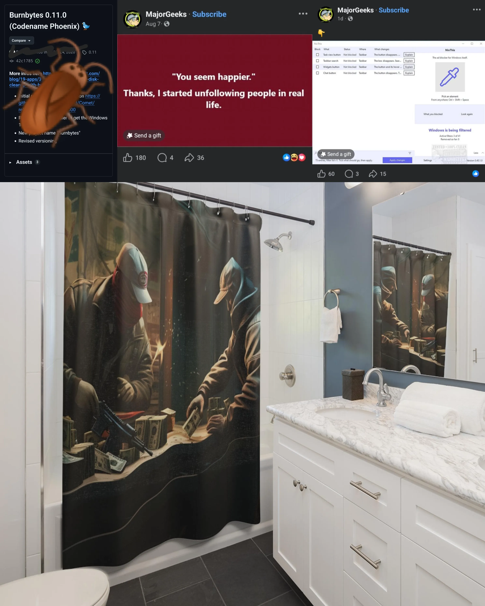</a>

- Julian Assange had the safety of an embassy. I don't know who's who, I'm just trying to warn you.

<a href="https://youtu.be/hMtZfW2z9dw" target="_blank">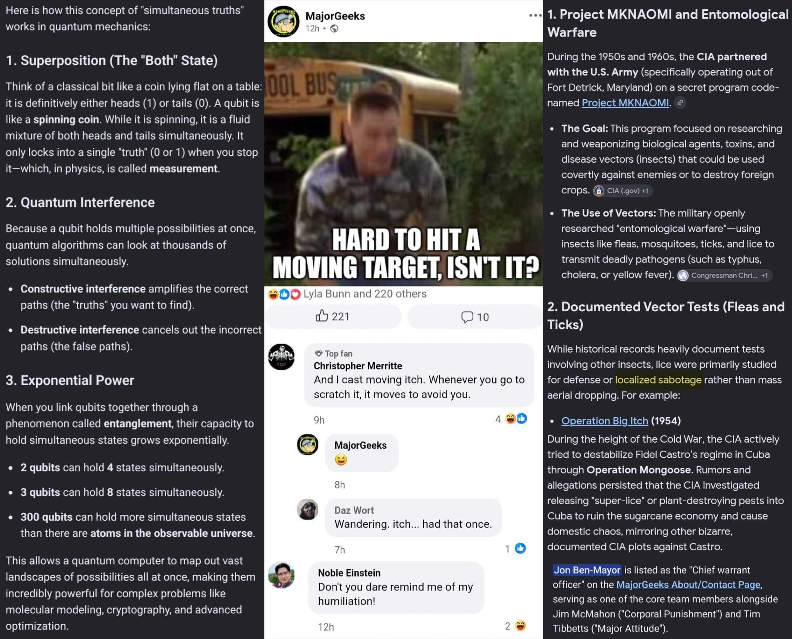</a>

- Who does this crap? Likely you've guessed it already. Nasties that want to bring you down to their level. Peepers, stalkers, creepers, losers, s*x-offenders, predators, weepers..and from the looks of it with venereal diseases. Spreading equity in misery. Maybe I'm misreading(unlikely), and if you think it's something else, I'm all ears.

<a href="https://youtu.be/jXvHtpUF9l0" target="_blank">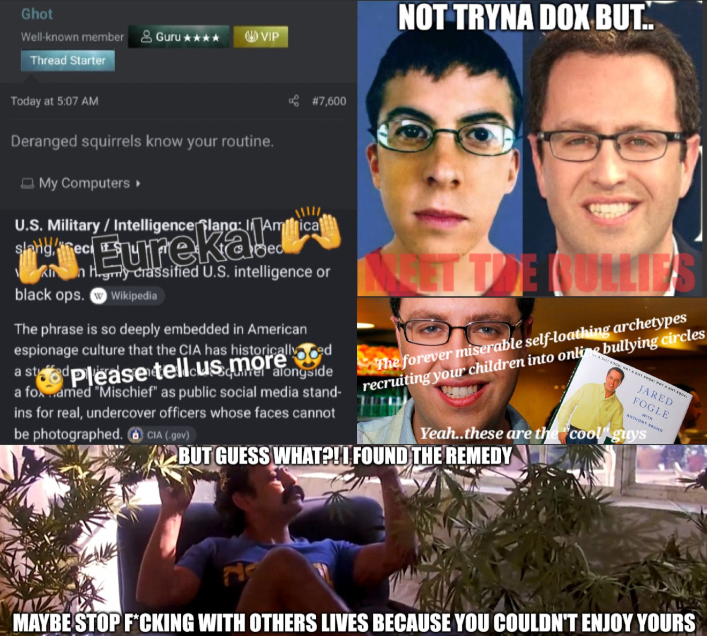</a>

- No matter which way you spin it, they're creeps, ***that's a fact.*** Think being a predator makes you a badass? What world are you even living in? Wait until you see what your local prison yard will do with you, tough guys and gals. Or go and have a visit with Samson and snap out of your miserable little lives.

